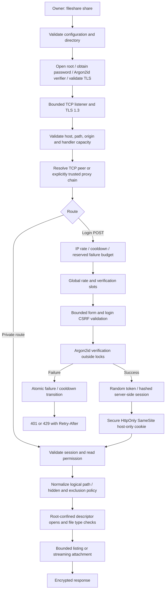

# Architecture

Fileshare is a single-process modular monolith. The CLI creates validated configuration; `internal/app` is the composition root and owns startup, listener, dependency lifetimes, background maintenance, and shutdown. File state remains on the host. Security state is memory-only.

The transport performs TLS negotiation before HTTP parsing. HTTP admission limits apply before route dispatch; login-specific IP/global admission applies before any expensive verification. Static CSS and the login form are public but still pass transport, request capacity, host/path/origin, and client address checks. Unknown or unsupported routes expose no files.

## Packages and contracts

| Package | Responsibility |
| --- | --- |
| `cmd/fileshare` | Process entry, signal context, exit status |
| `internal/cli` | Command/flag parsing, hidden password prompt or protected file input |
| `internal/config` | Defaults, typed settings and consistency checks |
| `internal/app` | Bootstrap and dependency ownership; HTTPS lifecycle |
| `internal/server` | Routes, middleware, CSRF, browser/API handlers, bounded listener/streaming |
| `internal/auth` | `Authenticator`, Argon2id verifier, `SessionStore`, hashed session map |
| `internal/security` | `IPGuard`, token buckets, cooldown/admission state, TLS, headers and proxy trust |
| `internal/files` | `FileService`, policy, retained `os.Root`, descriptor-based metadata |
| `internal/telemetry` | JSON logger and atomic resource/request counters |
| `internal/maintenance` | Context-controlled periodic cleanup and resource snapshots |
| `web` | Embedded templates and CSS; no runtime asset directory required |

The HTTP layer accepts narrow `Authenticator`, `SessionStore`, `IPGuard`, and `FileService` interfaces. The composition root selects concrete implementations. Token buckets are small private state objects protected by the guard's mutex, not separately synchronized dependencies.

## State and synchronization

`auth.Store` owns one mutex and a bounded map from SHA-256 token digest to creation/last-seen/absolute-expiry/read-permission metadata. Revocation deletes the entry. Request validation updates activity atomically. Idle and absolute expiration are synchronous; cleanup only reclaims space.

`security.Guard` owns one mutex for a bounded map keyed by normalized `netip.Addr`, its global rate bucket, and its global active-verification counter. Each IP record contains failed timestamps, cooldown end, violation history, last activity, in-flight count, and rate bucket. Admission reserves both simultaneous capacity and remaining failure budget. There is no unbounded wait queue or goroutine per rejected request.

The initial failure window is ten minutes. The fifth failure activates fifteen minutes of cooldown and clears the recent window. Subsequent violations within history retention double cooldown up to its cap. Successful login clears recent failures but leaves violation history and any already activated cooldown intact. Expiration is checked on entry and completion, as well as during maintenance.

Handler and transfer admission use nonblocking buffered-channel semaphores. The TCP listener wraps each accepted connection with a once-only release function. A mutex synchronizes shutdown with handler `WaitGroup` registration so waiting cannot race a newly admitted handler. Request counters and transfer metrics use atomics. No lock is held across password hashing or file streaming.

## Filesystem and streaming

Client paths are slash-relative logical names. Traversal, absolute paths, backslashes, NUL/control characters, colon syntax, empty components, dot components, and problematic trailing dots/spaces are rejected. HTTP also rejects encoded separators before `ServeMux` normalization. Exclusions are checked on every ancestor. Symlinks and non-regular special files are unavailable.

The filesystem service walks retained directory capabilities. Each client component must exactly match an entry in a bounded parent-directory scan, rejecting case/Unicode/short-name aliases that could bypass exclusions on a case-insensitive filesystem. Paths have at most 128 components. `Lstat` metadata is compared with the opened object's identity at every step; `os.Root` separately prevents traversal and symlink escape during races. Metadata and bytes come from opened descriptors, never from a user path joined to an absolute host path. Directory scans read batches, check cancellation, enforce an entry cap, then sort the bounded visible results. Metadata opens for names just obtained from a validated listing skip repeated spelling scans to avoid quadratic listing cost.

Downloads hold a global transfer permit and stream through `http.ServeContent` using a context-aware `ReadSeeker`. Range, If-Range, conditional dates, and HEAD keep the same authentication/policy checks. No whole-file read is used. Transfer/write deadlines and request cancellation bound normal network work; Unix nonblocking opens prevent FIFO replacement races. The host filesystem remains responsible for actual disk I/O behavior.

## Lifecycle and evidence

Bootstrap validates the selected address and certificate identity, rejects configured secrets in the share, opens a root capability, derives a verifier, creates bounded stores/guards, and embeds all web assets. It then binds the listener and starts maintenance. Startup failures release opened resources.

Shutdown first stops admissions and listening, then waits for existing operations within a grace deadline. On expiry it cancels request contexts and closes connections. Dependencies remain alive until active handlers leave, including non-cancellable Argon2 work. Maintenance stops, root handles close, and synchronous final logs complete.

Unit tests use deterministic times for session/window boundaries and concurrent state transitions. TLS integration tests use trusted local certificates. Security tests cover hostname/expiry/key validation. File fuzzing and symlink replacement tests exercise confinement; large sparse-file tests exercise streaming/cancellation without allocating the file's size in memory. Race detection checks shared state across those workloads.
